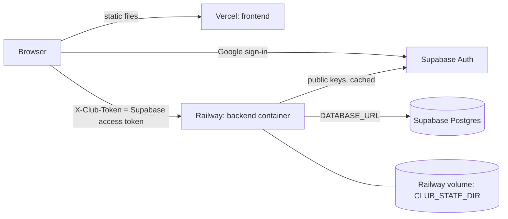

# Hosted demo

The hosted demo shows three things on a public address: sign in with Google,
chat with an AI answer, and the Contacts page. It has no Gmail connect and no
connectors. It is a course demo, not the production service in
[ADR 0007](adr/0007-hosted-web-service.md).

Each deployment has one owner. All data in the deployment belongs to the
`WORKSPACE_USER_ID` user. Each course member makes their own deployment.

## How the backend checks a request

1. `GET /healthz` needs no token and no origin check. It answers `{"ok": true}`.
2. The `Origin` header must be a local development origin or one of
   `ALLOWED_ORIGINS`. Otherwise: 403 `origin_not_allowed`.
3. The token is the `X-Club-Token` header on HTTP, or one entry of the
   WebSocket subprotocol list. It must be a Supabase access token: ES256
   signature from the project's public keys, not expired,
   `aud = authenticated`, and `iss = {SUPABASE_URL}/auth/v1`. Otherwise: 401.
4. The token's `email` must be in `ALLOWED_EMAILS` (case is ignored).
   Otherwise: HTTP 403 `{"error": "not_invited"}`. On the WebSocket, the
   server opens the socket and closes it at once with code 4403 and reason
   `not_invited`. A missing or invalid token refuses the WebSocket handshake,
   which a browser reports as close code 1006.

In hosted mode the shared club token and the WebSocket `?token=` query are not
accepted. When `SUPABASE_URL` is not set, the backend runs in local mode,
exactly as before.

## Settings

No values here. Set the values in the platform, never in the repository.

| Name | Set in | What it does |
| --- | --- | --- |
| `SUPABASE_URL` | Railway | The Supabase project address. When it is set, the backend is in hosted mode. The backend gets the token public keys from `{SUPABASE_URL}/auth/v1/.well-known/jwks.json`. |
| `ALLOWED_EMAILS` | Railway | Comma-separated emails that may use this deployment. |
| `WORKSPACE_USER_ID` | Railway | The Supabase user id (`auth.users.id`) that owns all data of this deployment. The backend refuses to start if the id is not a Supabase user. |
| `ALLOWED_ORIGINS` | Railway | Comma-separated web origins of the frontend, for example the Vercel address. Added to the CORS list and the origin check for HTTP and the WebSocket. |
| `PUBLIC_URL` | Railway | The public address of the backend. Used for links that the backend makes about itself. |
| `DATABASE_URL` | Railway | The Supabase Postgres connection string. |
| `CLUB_STATE_DIR` | Image default (`/data/club`) | Where the backend keeps its runtime files. Mount the Railway volume at this path. |
| `DEEPSEEK_API_KEY` | Railway | The model key for chat answers. |
| `PORT` | Railway (injected) | The port that the container listens on. The image uses 8080 when it is not set. |

The frontend has its own settings on Vercel (the Supabase address, the public
key for the browser, and the backend address). The frontend change documents
their names.

`python -m coworker.run --host 0.0.0.0` starts only when `SUPABASE_URL`,
`ALLOWED_EMAILS`, and `WORKSPACE_USER_ID` are all set in the environment. The
message names each missing setting.

## Railway service

The image is `backend/Dockerfile`, with `backend/` as the build context:
`docker build backend`. CI builds it on each pull request.

There is no `railway.json`. Railway has deprecated that file: new services
cannot use it, and existing files stop working on 2026-12-01
([Config as Code](https://docs.railway.com/reference/config-as-code)). Set
these in the service settings. Each line is to be confirmed at the first real
deploy:

- Root Directory: `backend`. Railway then finds `Dockerfile` by its default
  name ([Dockerfiles](https://docs.railway.com/builds/dockerfiles),
  [monorepo](https://docs.railway.com/deployments/monorepo)).
  The alternative is the service variable `RAILWAY_DOCKERFILE_PATH`.
- Health check path: `/healthz`. Railway calls it on `PORT` before it sends
  traffic to a new deploy
  ([health checks](https://docs.railway.com/reference/healthchecks)).
- Volume: mount it at `/data/club`. The image runs as a user that is not root,
  and Railway says such images need the service variable `RAILWAY_RUN_UID=0` to
  write to a volume ([volumes](https://docs.railway.com/volumes/reference)).
- Replicas: one.

## Database

Apply every file in `supabase/migrations/` to the Supabase database, in name
order, before the first start. Then sign in once with Google, so that Supabase
makes the `auth.users` row, and use that row's id as `WORKSPACE_USER_ID`.
